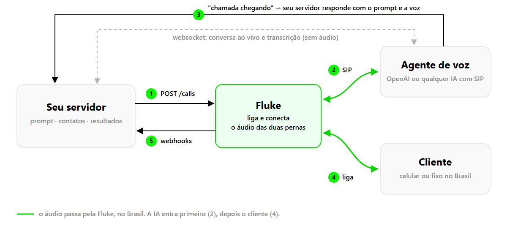

# Agente de voz com IA na API da Fluke

Notebook que liga para um celular ou fixo brasileiro com um agente de IA na linha. A Fluke faz a ligação a partir de um número brasileiro; a IA (aqui, OpenAI Realtime) entra por SIP.

O que o notebook mostra:

1. Saldo da conta e número que faz a ligação.
2. Servidor que aceita a chamada na OpenAI e recebe os webhooks da Fluke.
3. Uma ligação com a conversa transcrita ao vivo.
4. Webhooks e resultado final (duração, custo, código SIP).
5. Disparo para uma lista de contatos, com a tabela de atendeu / ocupado / não atendeu.
6. Como trocar a OpenAI por outra IA com SIP (ElevenLabs, LiveKit, Vapi, Retell, Asterisk).

## Como rodar

1. Python 3.10 ou mais novo. Node (para `npx`) ou `ssh` para o túnel temporário.
2. `pip install -r requirements.txt`
3. Copie `.env.example` para `.env` e preencha as chaves.
4. Abra `agente-de-voz-ia.ipynb` e rode de cima para baixo.
5. No passo 2 (Apontar os webhooks), cadastre a URL impressa no painel da OpenAI: Settings → Project → Webhooks, evento `realtime.call.incoming`.

Se o túnel cair, rode de novo a célula da URL pública e atualize a URL na OpenAI.

O passo 2 troca o webhook da conta Fluke inteira. Se a conta já manda eventos para outro sistema, use uma conta de teste.

## Por que a IA vai em `bridgeTo`

A Fluke disca primeiro o `bridgeTo` e, quando ele atende, disca o `to`. Com a IA em `bridgeTo`, ela já está na linha quando o cliente atende e responde ao "alô" na hora. Invertido, o cliente fica alguns segundos em silêncio até a IA entrar.

Documentação: https://fluke-5a9f9325.mintlify.app/guias/fazer-ligacoes
