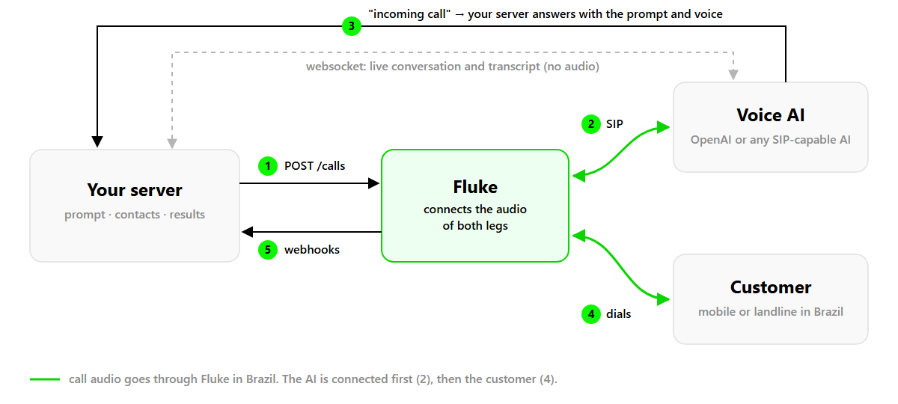

# Voice AI agent on the Fluke API

Notebook that calls a Brazilian mobile or landline with an AI agent on the line. Fluke places the call from a Brazilian number; the AI (OpenAI Realtime here) joins over SIP.

What the notebook covers:

1. Account balance and the number that places the call.
2. A server that accepts the call on OpenAI and receives Fluke's webhooks.
3. One call, with the conversation transcribed live.
4. Webhooks and final result (duration, cost, SIP code).
5. Calling a contact list, with an answered / busy / no answer table.
6. How to swap OpenAI for another SIP-capable AI (ElevenLabs, LiveKit, Vapi, Retell, Asterisk).

## How to run

1. Python 3.10 or newer. Node (for `npx`) or `ssh` for the temporary tunnel.
2. `pip install -r requirements.txt`
3. Copy `.env.example` to `.env` and fill in the keys.
4. Open `voice-ai-agent.ipynb` and run it top to bottom.
5. In step 2 (Point the webhooks), add the printed URL in the OpenAI dashboard: Settings → Project → Webhooks, event `realtime.call.incoming`.

If the tunnel drops, run the Public URL cell again and update the URL in OpenAI.

Step 2 changes the webhook for the whole Fluke account. If the account already sends events to another system, use a test account.

## Why the AI goes in `bridgeTo`

Fluke dials `bridgeTo` first and, once it answers, dials `to`. With the AI in `bridgeTo`, it is already on the line when the customer picks up and answers the "alô" right away. The other way around, the customer hears a few seconds of silence before the AI joins.

Docs: https://fluke-5a9f9325.mintlify.app/en/guides/making-calls
